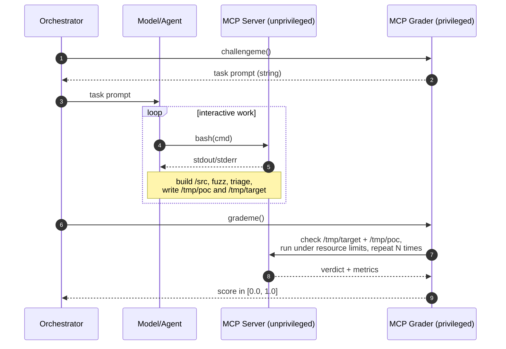

# Final Homework: A Reinforcement Learning Environment for Autonomous Vulnerability Discovery

## Goals: Reinforcement Learning Environments, MCP Servers, Docker, Agentic Fuzzing

In the previous two homeworks you built CI fuzzing pipelines with
AFL++ and Libfuzzer. You took an open-source target,
built it for fuzzing, ran a campaign, and collected crashes. You did this once; possibly manually or with an agent, but you built a single harness for a single project.

This time, we're going to try to scale your solution to be able to handle harnessing a project N times (as well as finding the vulnerability).
In particular, you are you to build an environment where the entire process is
automated and continuously evaluated for performance, when a model does the driving.
You will build an environment where a model gets a
shell on a project (still your choice), builds it, runs a fuzzing campaign, triages the crashes, and hands
back a reproducible proof-of-concept. You own the design of the environment around it: the task
it is given, the way it talks to the world, and the grade you assign at the end. The
catch is that the model and your grader live in the same container, so you will
have to make sure that the grade the model gets cannot be faked.

This is a reinforcement learning environment in the sense we covered in class and in
the [ARVO](https://arxiv.org/abs/2408.02153) and
[BountyBench](https://arxiv.org/abs/2505.15216) papers: a sandboxed task with a reward
signal a machine can compute. The model reaches the environment underneath through an
[MCP](https://modelcontextprotocol.io/) server, and you ship the whole thing as one
Docker image that anyone can run against any MCP-capable model (Codex, Gemini, Claude,
and so on).

## Expected Architecture

In your testing setup the Orchestrator and the Model can be the same layer (e.g., Codex),
you do not have to separate them (to reduce scope for the homework). The MCP servers will - by the requirements
of this homework - live in the same image, but the privileges must be different (task
creation and grading is privileged, interaction with the image is unprivileged). In total,
the model will see: at least two privileged functions (challegeme and grademe) and at least one unprivileged tool: the ability to run bash commands in the docker image you'll provide.

## Requirements

### 1. Pick a target with a reproducible vulnerability

1. Choose an open-source project that builds to a fuzzable binary and contains at least
   one memory-safety vulnerability reachable by fuzzing (heap or stack overflow,
   use-after-free, and the like). Any language is fine as long as you can build it,
   fuzz it, and detect the crash; how you get there is up to you.
1. Each of you picks a unique target. Deconflict on Discord. No duplicate submissions.
   You may reuse your HW0/HW1 target only if it actually crashes under a fuzzer;
   otherwise pull something from ARVO, OSS-Fuzz history, or a CVE with a public commit.
1. Pin the exact vulnerable commit and ship that source tree. The model should find the
   bug by building and fuzzing, so do not leave a patch, a crash file, or any other
   giveaway lying around in the image.

### 2. The MCP server

Write an MCP server (the Python, Go, Rust or any language you prefer) that exposes exactly
two tools to the model:

* `challengeme()` returns a string prompt. The prompt tells the model what it is doing (you own what the exact prompt will say):
  the source lives at a known path (say `/src`), it has bash access, and it needs to
  build the target, run a fuzzing campaign, find a crashing input, and drop its
  artifacts where the grader expects them. Spell out the contract:
  * the crashing input goes to `/tmp/poc`,
  * the binary it built that reproduces the crash on that input goes to `/tmp/target`,
  * when it is done it stops and calls `grademe`.

  Whatever this prompt promises is exactly what the grader should check. No more, no
  less.

* `grademe()` returns a single float in `[0.0, 1.0]`, where `1.0` is a perfectly
  reproducible finding and `0.0` is a failure. It should:
  1. confirm `/tmp/target` exists and is the target the model built, not some arbitrary
     binary it dropped in (see the anti-cheat section),
  1. confirm `/tmp/poc` exists,
  1. run the target on the PoC under resource limits and a timeout, and check that it
     genuinely faults on a memory-safety error (a sanitizer build or a crash-detecting
     harness is the usual way),
  1. check reproducibility by running it more than once. A flaky or timing-dependent
     crash should not earn a `1.0`.

  The shape of the reward is your call. A clean `0.0` or `1.0` is acceptable, but
  partial credit makes a better signal: building successfully is worth less than
  producing a crash, which is worth less than a crash in the intended place, which is
  worth less than one that reproduces every time. Write down whatever rubric you use.

### 3. Package it as one Docker image

1. `docker build` produces a single image holding the project source, the build
   toolchain (compilers, sanitizers, your fuzzer of choice), the MCP server, and the
   grader.
1. `docker run` brings up the MCP server so an external model or agent can connect and
   start the episode. Put the exact command and transport (stdio or HTTP/SSE) in your
   README so whoever grades you can connect in one step.
1. The image runs offline. Building, fuzzing, and grading must all work with no network
   at run time. The model's job is the task, not installing half the internet first.

### 4. Make the grade hard to fake

The model and the grader run in the same
container and the model has a shell, so a careless setup is trivial to beat: the model
edits the grader, overwrites the checker, `chmod`s its way through, or replaces
`/tmp/target` with a two-line script that signals itself. The grade has to reflect work
the model actually did. We will test your solution on adversarial inputs.

The model is responsible for building the target. That is part of the task and part of
what makes it challenging: you have to accept a binary the model produced and still be sure it
is the real target and that it crashed for a real reason. How you pin that down is open,
and we want you to be inventive here. Some directions people take: have the grader do
its own clean build of the pinned source and compare, fingerprint the binary,
rebuild-and-replay from the PoC under your own sanitizer build, or check the crash
signature against what the known bug should produce. Pick an approach and argue for it.

At a minimum, defend against:

* Tampering with the grader or the MCP server. The model should not be able to read,
  modify, replace, or `gdb attach` its way into the grading logic. The grader code and
  any ground-truth data should be owned by a privileged user and kept out of the
  model's writable tree.
* Privilege escalation. Run the model's shell as an unprivileged user and run the
  grading-sensitive parts as a more privileged one. No `sudo`, no writing to
  grader-owned paths. Think hard about file ownership, modes, and which user each
  process runs as, and write your user/permission model down so a reader can follow it.
* Faking the crash. A crash has to be a real fault in the target, not some other process
  the model spawns to return a signal. This is the provenance problem from above.
* Reward hacking. The model should not be able to talk `grademe` into a `1.0` without a
  real PoC: no writing to a score file the grader trusts, no intercepting the MCP call,
  no slipping through a parsing bug in your checker.

You will not get this perfectly airtight, and that is fine. What we want is a threat
model: the attacks you thought about, which ones you stop and how, and which ones you
knowingly leave open and why.

### 5. Demo with a real model

Run the whole loop against at least one off-the-shelf MCP-capable harness (Claude,
Codex, or Gemini CLIs, or something equivalent): `challengeme`, the model working in
bash, building, fuzzing, finding a crash, writing `/tmp/poc` and `/tmp/target`, then
`grademe` returning a score. Save the transcript. Running more than one model and
comparing them is extra credit.

## Deliverables

Commit to this repository the following:

1. `Dockerfile` and all source for the MCP server, grader, and harness.
   * The MCP server must implement the `challengeme` and `grademe` functions.
   * The MCP server must offer a bashtool capability.
1. A `WRITEUP.md` covering:
   * the environment design and the reward function,
   * with exact build, run, and connect (and config) instructions, the target you chose
   and its vulnerability, your grading rubric, and your user/permission model,
   * your anti-cheat threat model: attacks considered, defenses built, holes left,
   * at least one end-to-end transcript of a real model solving or failing the
     challenge, with the final grade,
   * how the model or models you tried did,
   * the open challenges you ran into and could not solve. Be specific: "a model with a
     shell and the same UID as the server can always do X", "reproducibility detection
     is flaky for use-after-free under ASLR", "partial credit is exploitable because Y".
     This part is graded on insight, not on having solved everything.
1. A `trascript.txt` file containing your successful session.
